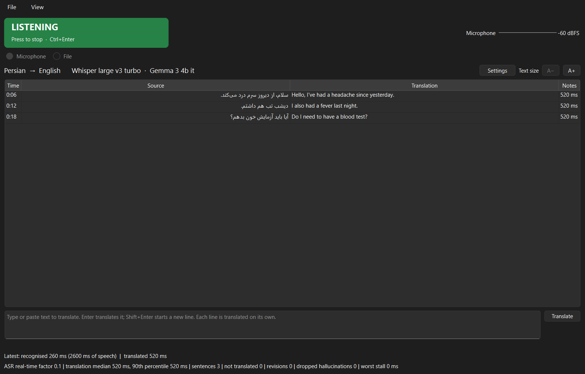
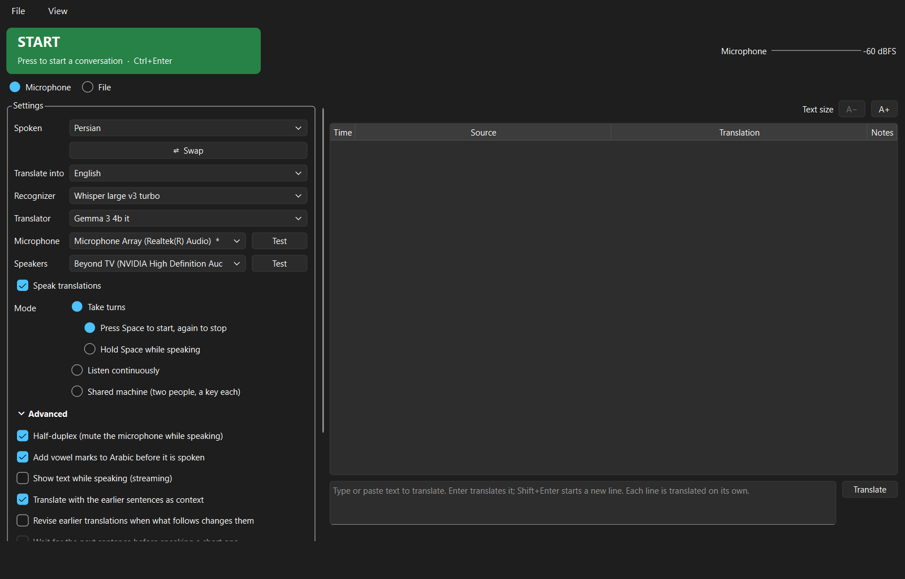
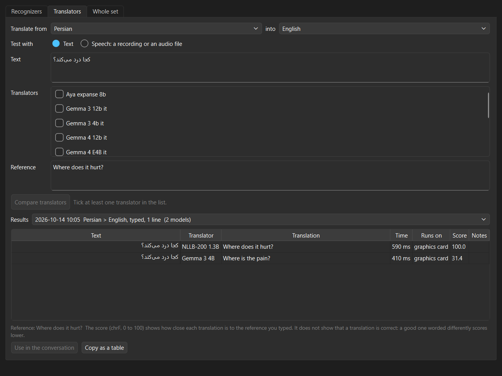
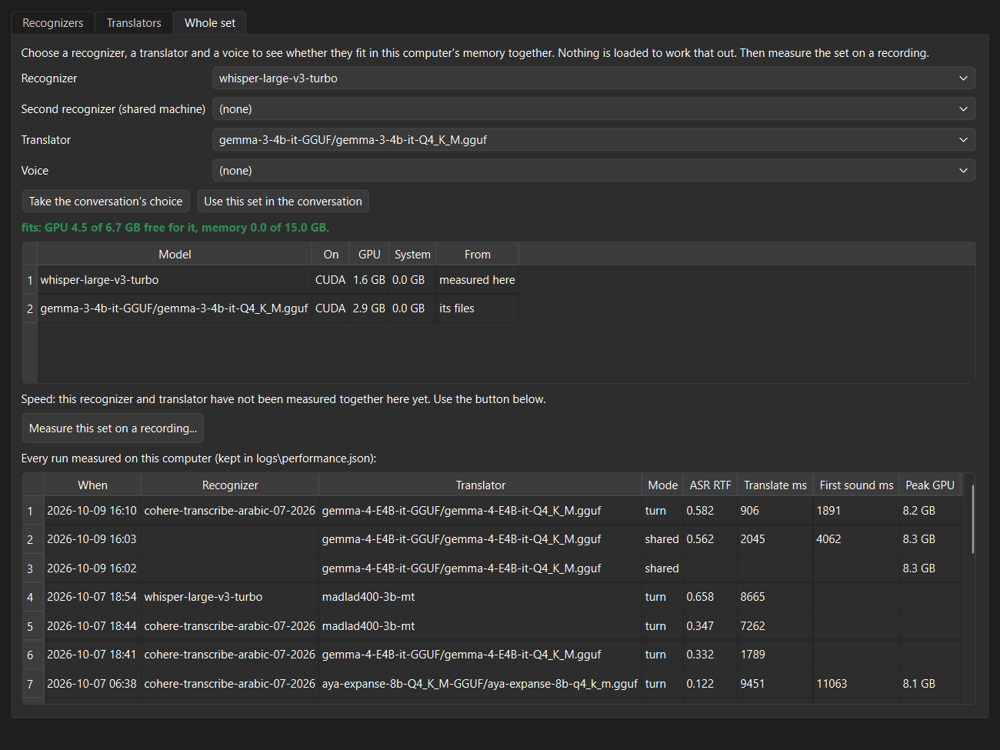

# Volis: an overview

What Volis is, what it does well today, what it is still growing into, and what it takes to run
it. Written for people deciding whether and how to use it. To install and use it, see
[README.md](README.md).

## In one paragraph

Volis is a speech translator that runs entirely on one Windows computer. A person speaks; Volis
writes down what they said, translates it, shows both on the screen, and says the translation
aloud in the other language. Once it is installed it needs no internet connection at all, and
nothing said in the room is sent anywhere. It is built first for **Arabic**, both Modern
Standard Arabic and spoken dialects, and for **Farsi (Persian)**, with English and Spanish
alongside. It also translates recordings and typed text, and it includes tools for checking
translation quality and what a computer can handle.

## Why it exists

Many conversations that need a translator can't use the usual tools:

- **The conversation is sensitive.** Online translation apps send the audio to a company's
  servers. For a medical history, a legal matter, a case file or a personnel issue, that may not
  be acceptable. Volis keeps every word on the computer in front of you.
- **There is no reliable internet.** A field site, a basement office, a vehicle, a building with
  poor reception. Volis works the same with the network cable unplugged.
- **An interpreter isn't available for every conversation.** Volis can cover the routine
  exchanges at a front desk or in an intake interview, and it is available at any hour.
- **Cost and control.** There is no per-minute fee and no subscription. Volis is set up for each
  organisation, and its quality can be checked on the organisation's own recordings.

Volis is a help, not a certified interpreter. Machine translation makes mistakes (see
[Limits to know](#limits-to-know)). For consent, diagnosis, legal statements and similar
moments, a qualified interpreter is still the right choice.

## How it works

Every sentence goes through four steps, each done by an AI model running on the computer:

| Step | What happens |
|---|---|
| 1. Listen | Volis notices when someone starts and stops speaking. |
| 2. Write down | The speech becomes text in the speaker's language. |
| 3. Translate | The text is translated into the other language. |
| 4. Speak | The translation is read aloud. |

**Speed.** On a suitable computer, writing a sentence down takes a fraction of the time it took
to say, and translating it takes about half a second. In our measured runs the translation began
to be spoken within about two seconds of the speaker finishing.

### Set up for each customer

Which AI models do the work is decided when Volis is set up for a customer: by the languages and
dialects they need, the computers they have, and the licence terms their use allows. The people
using Volis don't have to deal with models; at most they get a simple choice or two. New and
better models appear every few months, and a customer's setup can be updated to use them without
changing how Volis is used.

## Current focus: Arabic and Farsi

| Language | Understands speech | Translates | Speaks aloud | How well tested |
|---|---|---|---|---|
| **Arabic, Modern Standard** | Yes | Yes | Yes | Measured on test recordings; tried in live conversations |
| **Arabic, Iraqi** | Yes | Yes, in Iraqi wording | Yes, with a standard Arabic voice | Tried in live conversations; not measured |
| **Farsi (Iranian Persian)** | Yes | Yes | Yes (a new voice) | Measured on test recordings; the voice not yet judged by Farsi speakers |
| **English** | Yes | Yes | Yes | In daily use; not measured |
| **Spanish** (Mexico, Spain) | Yes | Yes | Yes | Measured on test recordings |

### Arabic

- **Standard and dialect.** You tell Volis which Arabic is spoken and which is wanted. Iraqi and
  Jordanian Arabic are named choices today; anything else is treated as Arabic in general.
  When asked for Iraqi Arabic, Volis translates into everyday Iraqi wording rather than the
  formal written standard. Where that isn't possible, it writes standard Arabic and says so
  beside the sentence.
- **Accuracy.** On test recordings of people reading standard Arabic, the best setup we have
  tested got about two letters in a hundred wrong when writing the speech down. In a trial, the
  same sentences spoken in standard Arabic and in Iraqi Arabic gave the same English translations.
- **Voices.** Male and female Arabic voices are available. Arabic is normally written without
  its short vowels, which makes any voice mispronounce some words. An option adds the vowel marks
  before a sentence is spoken. Its marks are good but not perfect, and no Arabic speaker has yet
  judged whether they make the voices clearer.
- **Dialect speech.** Recognition tuned for Arabic dialects is available but has not yet been
  tested on dialect speech.

### Farsi (Persian)

- **Accuracy.** See the example below.
- **A clean-up step** tidies Farsi text before it is translated: letters that look the same in
  Arabic and Farsi but are different characters, and the "half-space" that joins the parts of a
  Farsi word.
- **Voice.** A Farsi voice is now available, so translations into Farsi are spoken as well as
  shown. Farsi, like Arabic, is normally written without its short vowels, so the voice will
  mispronounce some words. It is new, and no Farsi speaker has yet judged how often that happens.
- **Variety.** Iranian Persian. Afghan Dari has not been tested.

### Other languages

German, French, Italian, Portuguese and Russian are named in Volis, and the underlying models
cover many more. Each language spoken aloud needs a voice for it. Where a computer has no voice
for a language, translations into it are shown on the screen and the conversation carries on,
in every mode.

## An example: Farsi to English

Picture a reception desk: a Farsi-speaking visitor and an English-speaking member of staff,
sharing one computer.

**What happens.** The visitor says a sentence in Farsi. Volis writes it down in Farsi, tidies the
Farsi script, and translates it into English, taking the last few sentences into account. The
Farsi and the English both appear on the screen, and the English is spoken, about two seconds
after the visitor stops.

**The reply.** Each person has their own key. The staff member presses theirs and answers in
English; the answer appears in Farsi on the screen and is spoken in Farsi. (This two-key mode is
built and checked by tests, and is waiting for its first trial with two people.)

**Afterwards.** The whole conversation, both languages, can be saved as text to read later.

**How accurate it is today.** On test recordings of people reading Farsi news sentences, Volis
got about four to seven letters in a hundred wrong when writing the speech down, depending on the
setup. Given the correct Farsi text of those sentences, its translations scored between about 60
and 70 out of 100 against professional translations (see
[how to read the scores](#how-to-read-the-scores)).

**Where it falls short: everyday speech.** News sentences are formal. Everyday speech is harder,
and one test showed how. Asked to translate the everyday Farsi for "Can I look at the menu,
please?", all nine translation models we tried got it wrong; most said "Can I see you, please?".
The Farsi word for "menu" is spelled exactly like the everyday word for "me", and every model
chose "me". Writing "food menu" instead fixed it for all nine. Putting a restaurant sentence
before it fixed it for two, while three of the smaller models invented words instead ("my order",
"my reservation").

**What this means.** Published scores, measured on formal text, would never have shown this.
Testing with the sentences a customer actually uses does, which is what the Test bench is for
(below). Two planned features address it directly: a way to see other possible translations of a
sentence, each shown back in Farsi so the speaker can confirm it; and a phrasebook of checked
translations for common sentences, which is under consideration.

## Ways to use it

### Live conversation

Pick a mode; you can change it while a conversation is running.

| Mode | How it works | Suits | Status |
|---|---|---|---|
| **Take turns** | Press a key, speak, press it again. Only then is the speech translated. | Most meetings: nothing is picked up by accident. | Ready |
| **Listen continuously** | Hands-free. Every pause ends a sentence. | One person speaking at length. | Ready |
| **Shared machine** | Two people at one computer, each with their own key and language. What one says is spoken in the other's language. | Across a desk or a counter. | Built; not yet tried by two people |
| **Pair two computers** | Each person has their own computer. Each translates its own person's speech and sends the text to the other over the local network, never the internet. | Two rooms, or a little distance. | Built; not yet tried on two real computers |

During a conversation the settings fold away and the text fills the window, in a size you can
adjust. Arabic and Farsi are laid out right to left. Microphone and speaker **Test** buttons check
the sound before you start.

### Recordings

Open an audio file (WAV, MP3, M4A, FLAC, OGG or Opus) and Volis transcribes and translates it.
Each sentence becomes a row; click a row to hear that part of the recording. It can run at
normal speed or as fast as the computer allows. **Export** saves the transcript, the translation
and subtitle files. Useful for recorded interviews, voicemail and statements.

### Typed text

A box under the conversation translates typed or pasted text, and speaks it if speech is on. It
helps with names, addresses and numbers, and in a room too noisy for speech. It works during a
conversation as well, and the typed line is translated with the conversation's context.

## Quality and safeguards

- **Errors caught before anyone hears them.** AI models sometimes "hear" stock phrases in
  silence ("Thanks for watching"), or answer a question instead of translating it, hand the
  sentence back unchanged, or ramble. Volis drops those sentences rather than show or speak them,
  and says why.
- **Earlier sentences as context,** so words like "he", "she" and "it" come out right.
- **Revision.** A short sentence whose meaning only becomes clear from the next one is corrected
  on the screen.
- **Names and terms to keep exactly,** entered as a short list for the session.
- **The microphone is muted while Volis speaks,** so it doesn't translate itself. (Not needed with
  a headset.)
- **The Farsi clean-up and the Arabic vowel marks** described above.

## Checking quality: the Test bench

The Test bench (View > Test bench) compares the AI models that can do each step, on real
material, without technical help. It is how a customer's setup is chosen, and customers can use
it to check quality for themselves. It answers three questions:

| Tab | The question | What you give it | What you get |
|---|---|---|---|
| **Listening** | Which setup writes our speakers' words down most accurately? | A recording made on the spot, or an audio file. Optionally, what was really said. | What each one wrote, how long it took, the memory it needed, and how many letters and words it got wrong. |
| **Translating** | Which setup translates our sentences best? | Typed or pasted text, or a recording. Optionally, a translation you trust. | Each translation side by side, its time, and how close it came to the trusted one. |
| **Whole set** | Will this combination run on this computer? | The models for each step. | Whether they fit in memory together (worked out without loading anything), and a button that times them on a recording. |

(In the program the first two tabs are called Recognizers and Translators.)

Every comparison is kept and can be copied as a table into a report.

### How to read the scores

- **Writing down:** fewer wrong letters is better. Two in a hundred means one or two slips in a
  typical sentence.
- **Translating:** the score (0 to 100) shows how close a translation is to a translation you
  trust. A high score means "close to that wording", not "correct": a good translation in
  different words scores lower. The scores are a guide for comparing; reading the translations is
  still the real test.

## Machine performance

Volis runs on the computer's graphics card, and the models must fit in its memory. Three things
help plan for that:

- **A warning before starting.** If the chosen models won't fit together, an orange line says
  so, before anything is loaded.
- **The Whole set tab** of the Test bench shows how much memory a combination needs and how
  much is free, keeps every timed run on that computer, and so helps decide what hardware to buy.
  On a laptop with an 8 GB graphics card, a typical setup uses about 4.5 GB and leaves about
  3.5 GB for other programs. A 16 GB card can run larger models, which translate somewhat better.
- **The performance panel** (View > Performance) shows, while a conversation runs, how much of
  the graphics card, memory and processor Volis and other programs are using, how long each
  sentence took at each step, and whether Volis is keeping up with the speaker. It turns amber or
  red when memory is nearly full or speech is falling behind. Useful when Volis has to share the
  computer with, say, a video-call program.

## Privacy and data

- **No internet after installation.** No cloud service, no account, no usage reporting. Pairing
  two computers uses the local network only.
- **What stays on the computer:** the settings; a log of each session, which includes what was
  said and how it was translated; any conversation you choose to save; and the Test bench's
  results.
  Treat the computer as holding sensitive records, and delete the logs as your policy requires.
- **Live conversations are not recorded as audio.** A recording made in the Test bench is held
  in memory only, until Volis is closed.

## What it needs

| | |
|---|---|
| **Computer** | Windows 10 or 11, 64-bit |
| **Graphics card** | NVIDIA, with 8 GB of memory or more (16 GB for the largest models) |
| **Disk** | About 6 GB for the program, plus its models: about 15 GB in all for a typical setup |
| **Sound** | A microphone and speakers; a headset works best |
| **Not supported** | Mac, Linux, and computers without an NVIDIA graphics card |

There are two ways to install it:

- **A ready-made folder.** The program and its models are copied onto the computer as one folder.
  Nothing else is installed except the graphics card's driver, and no internet is needed. This
  is how Volis reaches the people who will use it. (Being verified on a second computer.)
- **Full setup** for whoever maintains Volis: about an hour, with an internet connection, as
  described in [README.md](README.md).

## Licences of the AI models

The AI models Volis runs are made by other companies and research groups, and each comes with
its own licence. Several otherwise excellent ones allow non-commercial use only. Each customer's
setup is chosen with the intended use in mind, and the licences should be reviewed before any
commercial use.

## Where it stands today

| Ready | Built, awaiting a real-world trial | Planned next |
|---|---|---|
| A conversation on one computer, taking turns or listening continuously | Two people sharing one computer | Help pages inside the program, with a **?** beside each option |
| Translating recordings, with export | Two computers paired | Fixing a sentence: other ways it could have been heard or translated, each translation shown back in the speaker's language so someone who can't read the target language can check it |
| Translating typed text; saving a conversation as text | The ready-made folder on another computer | Saving each conversation automatically, as an option |
| The Test bench and the performance panel | | A simple choice or two in place of the model lists |
| Farsi clean-up and the Farsi voice; Arabic vowel marks | | Guided tutorials |

**Under consideration:** glossaries of fixed terms and a phrasebook of checked translations for
common sentences. Both are being thought through before they are built (the "menu" case above
shows why a word with two meanings needs care).

## Limits to know

- **Machine translation makes mistakes,** and a fluent-sounding wrong translation is the hardest
  kind to notice. Use Volis for routine exchanges; use a qualified interpreter where an error
  would matter.
- **Most testing so far is on clear, read speech.** Everyday speech, slang, noisy rooms and people
  talking over each other are harder. A very quiet speaker straight after a loud one may be
  missed.
- **Dialects.** Iraqi Arabic is a named choice; other dialects are treated as Arabic in general.
  Afghan Dari has not been tested.
- **The Farsi voice is new.** No Farsi speaker has yet judged it, and like the Arabic voices it
  will mispronounce some words written without their short vowels.
- **Windows and NVIDIA graphics cards only.**

## Further reading

| Document | For |
|---|---|
| [README.md](README.md) | Installing Volis and using it, step by step |
| [MODELS.md](MODELS.md) | For whoever sets Volis up: the models tested and their scores |
| [SETTINGS.md](SETTINGS.md) | Every setting |
| [DEVELOPMENT.md](DEVELOPMENT.md) | For whoever builds and maintains Volis |
| [HANDOFF.md](HANDOFF.md) | Detailed status, history and priorities |
