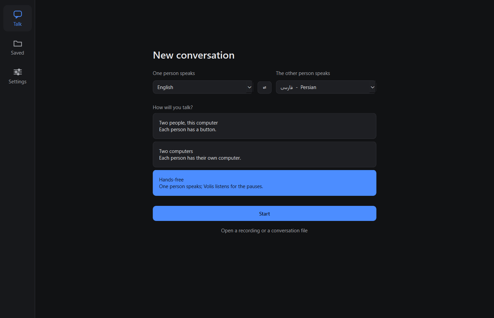
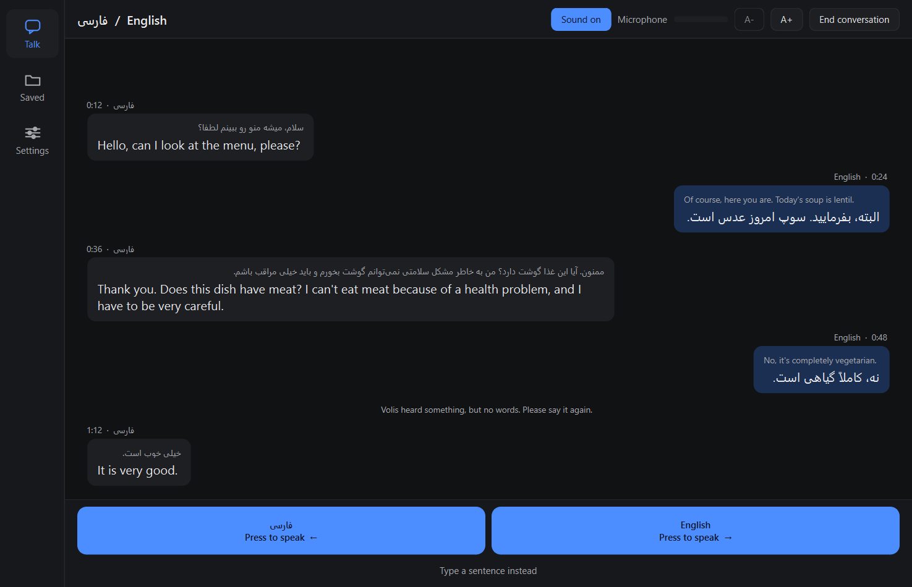
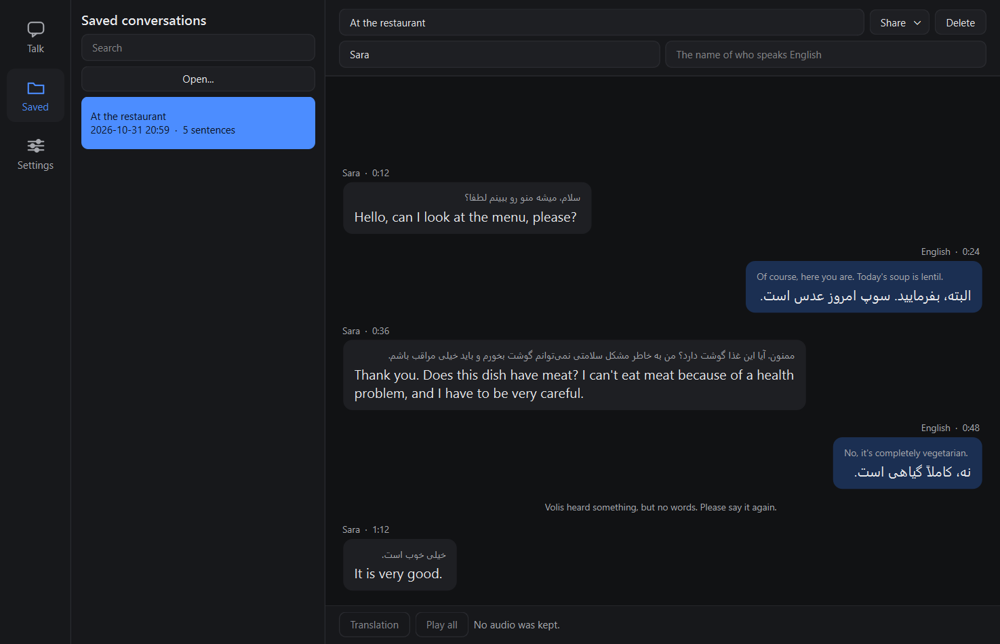

# Volis

Volis is a live interpreter that runs entirely on your own computer. One person speaks; Volis
writes down what they said, translates it, shows both, and says the translation aloud in the
other language. Two people who don't share a language can hold a conversation through it.

**After initial install, no internet is needed.** You need a connection once, to install it and download the
speech and translation models. After that it works with the network cable unplugged, and
nothing you say leaves the machine.

## What you need

- **Windows 10 or 11**, 64-bit.
- **An NVIDIA graphics card with 8 GB of memory or more**, with a current driver.
- **About 15 GB of free disk space** for the program and a basic set of models. More models
  need more space.
- **A microphone and speakers.** A headset is best: with speakers, Volis mutes the microphone
  while it talks so it doesn't hear itself.
- **An internet connection for the setup below only.**
- **About an hour for the setup**, most of it waiting for downloads. One step (step 3) installs
  two free tools from Microsoft and NVIDIA so that translation runs on the graphics card.
- **Two small free tools, Git and uv.** [First, install two tools](#first-install-two-tools) below
  installs them.

Every command on this page is for **PowerShell**.

If someone gave you a ready-made Volis folder, skip to
[If you were given a ready-made folder](#if-you-were-given-a-ready-made-folder).

## First, install two tools

About 5 minutes. Git fetches Volis. uv installs
everything Volis needs. uv has to be **version 0.11.26**: a newer uv refuses to set Volis up,
so use the line below and not another way of installing it.

1. Open PowerShell. Paste this line and press Enter:

   ```powershell
   winget install --id Git.Git -e
   ```

   If Windows asks to allow changes, choose **Yes**. Wait for `Successfully installed`.
   (If it says Git is already installed, that's fine.)

2. Paste this line and press Enter:

   ```powershell
   powershell -ExecutionPolicy ByPass -c "irm https://astral.sh/uv/0.11.26/install.ps1 | iex"
   ```

   Wait until it prints `everything's installed!`

3. **Close PowerShell and open a new PowerShell window.** The two tools only work in a window
   opened after they were installed.

4. In the new window, check both:

   ```powershell
   git --version
   ```

   ```powershell
   uv --version
   ```

   ✅ The first prints `git version` and a number. The second prints `uv 0.11.26`.

   If the second prints a different number, another uv was installed on this computer
   earlier. See "`setup.ps1` says uv is the wrong version" under
   [If something goes wrong](#if-something-goes-wrong).

## Set it up

1. **Get Volis** and go into its folder:

   ```powershell
   git clone https://github.com/Cvio/volis.git
   cd volis
   ```

2. **Install it:**

   ```powershell
   .\setup.ps1
   ```

   This downloads Python and everything Volis needs into this folder (several GB, so it
   takes a while the first time) and then checks the result. Nothing is installed anywhere
   else on your computer.

   ✅ It should end with `All checks passed.` It will also say, in yellow, that the translator
   will run on the processor. That's expected at this point: the next step fixes it.

3. **Put the translator on the graphics card.** Don't skip this. Without it Volis still
   works, but the translator runs on the processor and every sentence takes several seconds
   instead of about half a second. It is done once per computer and takes 30 to 45 minutes,
   most of it waiting.

   It needs two free tools installed first. Do the four parts in order.

   **Part A: install Microsoft's build tools** (about 10 minutes, about 7 GB of disk)

   Skip Part A if this computer already has Visual Studio 2022 or 2026 (the full program or
   its "Build Tools") with **Desktop development with C++** installed. Either year works.

   1. Paste this line into PowerShell and press Enter:

      ```powershell
      winget install Microsoft.VisualStudio.2022.BuildTools --override "--passive --wait --add Microsoft.VisualStudio.Workload.VCTools --includeRecommended"
      ```

   2. If Windows asks "Do you want to allow this app to make changes to your device?",
      choose **Yes**.
   3. A window titled *Visual Studio Installer* opens and shows a progress bar. **Wait.** You
      don't need to click anything in it. It closes by itself.

   ✅ PowerShell prints `Successfully installed`.

   **Part B: install NVIDIA's CUDA Toolkit, version 12.9** (about 15 minutes, about 3 GB to
   download)

   Use version **12.9**. Newer versions (13 and up) don't work with Volis.

   1. Open this page in your browser: <https://developer.nvidia.com/cuda-toolkit-archive>
   2. In the list, click the highest entry that starts with **CUDA Toolkit 12.9**.
   3. On the next page, click these buttons, in order: **Windows**, **x86_64**, **11** (choose
      11 on Windows 10 too), **exe (local)**. A **Download** button appears. Click it and wait
      for the download to finish.
   4. Open the downloaded file (its name starts with `cuda_12.9`). If Windows asks to allow
      changes, choose **Yes**. Click **OK** to accept the folder it suggests, and wait while it
      unpacks.
   5. Click **Agree and continue**.
   6. Choose **Custom (Advanced)**, then **Next**.
   7. You see a list with tick boxes. **Untick everything except the one named `CUDA`.** This
      matters: the other boxes would replace your graphics driver with an older one.
   8. Click **Next**, then **Next** again, and wait for it to finish. Then **Close**.

   ✅ This folder now exists: `C:\Program Files\NVIDIA GPU Computing Toolkit\CUDA\v12.9`

   **Part C: build the translator's engine** (10 to 20 minutes)

   1. In PowerShell, in the Volis folder, run:

      ```powershell
      .\build-llama.ps1 -Cuda
      ```

   2. **Wait.** Lines of text scroll past for a long time, and sometimes it looks stuck for a
      minute or two. That's normal. Don't close the window.

   ✅ The last line begins `Successfully built` and ends in `.whl`.

   If it stops with `STOP: Visual Studio Build Tools (C++) are not installed`, do Part A
   again. If it stops with `STOP: no CUDA Toolkit 12.x`, do Part B again.

   **Part D: install what you built**

   1. Run the setup again:

      ```powershell
      .\setup.ps1
      ```

   ✅ Near the end you should see both of these lines:

   ```
   ok    llama_cpp 0.3.35, GPU offload: yes
   The translator will run on the graphics card.
   ```

   If it says `GPU offload: no`, or `The translator will run on the PROCESSOR`, Part C didn't
   finish. Run Part C again and read its last lines.

4. **Get the models.** Volis uses four kinds:

   | Model | What it does | Do you choose it? |
   |---|---|---|
   | **Speech detector** | Notices when someone starts and stops talking | No: there is one, and it is required |
   | **Recognizer** | Turns the speech into text | Yes |
   | **Translator** | Translates the text | Yes |
   | **Voice** | Says the translation aloud | One for each language you translate into |

   This gets a set that works for English and Spanish on an 8 GB card, about 4.5 GB in all:

   ```powershell
   .\fetch-models.ps1 -Only silero_vad,lessac,es_MX-claude                          # the speech detector, an English voice, a Spanish voice
   .\fetch-model.ps1 openai/whisper-large-v3-turbo -Role asr                        # the recognizer
   .\fetch-model.ps1 unsloth/gemma-3-4b-it-GGUF -Role mt -Include "*Q4_K_M.gguf"    # the translator
   ```

   For other languages, a larger graphics card, or to choose your own models, see
   **[MODELS.md](MODELS.md)**. It says what to pick for 8 GB and 16 GB cards and how to
   find and try models yourself.

5. **Check that Volis sees them:**

   ```powershell
   .\.venv\Scripts\python.exe -m volis --report
   ```

   ✅ Every model listed should say `ok`.

## Start it

```powershell
.\.venv\Scripts\python.exe -m volis
```

A window opens, with a console window behind it that shows what Volis is doing.



1. Choose the two languages. The **⇄** button swaps them.
2. Choose how you will talk (see the table below).
3. Press **Start**. The first time, loading takes a minute or so. Volis remembers your choices.

Before your first conversation, open **Settings** on the left, choose your **Microphone** and
**Speakers**, and press **Test** beside each. **Test** beside Speakers says a short sentence.
**Test** beside Microphone records you for 3 seconds, plays it back and shows what Volis heard.

## Have a conversation

| How you talk | What to do |
|---|---|
| **Two people, this computer** | Each person has a big button, or the left and right arrow keys. Press once to start speaking and again when you finish. Escape cancels a turn. |
| **Two computers** | Each person has their own computer, on the same local network. Press Start on both. On one of them, click the other computer's name in the list. If it isn't listed (some office and guest networks hide it), type the address the other computer shows and press **Connect**. The other person then presses **Accept**. After that, press **Talk** (or Space) to speak, and again when you finish. |
| **Hands-free** | One person speaks, and Volis translates each time they pause. No buttons. Settings has the length of the pause. |



Each person's words stay on their own side. The translation is in large letters, with what was
said smaller above it. The buttons always say what is happening, and everyone waits while Volis
speaks.

**To hear a sentence again,** click it. A small player appears, with play, pause and a timer.

**Sound on** at the top turns the spoken translations off or on; they are always shown. **A-** and
**A+** make the text smaller or larger. The **Microphone** bar turns red if Volis can't hear
anything.

**To type instead,** press **Type a sentence instead**. It is useful in a noisy room, or for a
name, an address or a number.

**If something goes wrong,** a box says what happened in plain words, with a button to fix it when
there is one. **Details** shows the technical message, to pass on to whoever set up Volis.

## When it ends

Press **End conversation**. Volis asks for a name, and whether to keep the audio. **Save** keeps it
and **Delete** throws it away. To name the speakers, type their names; otherwise each is shown by
their language.

**On two computers,** either person can end it, and it ends for both. The computers then share the
conversation's audio, so that each has every sentence and its translation. Wait for that to finish.
If the connection has dropped, Volis says so: ask the other person to share the conversation as a
**Volis conversation file**, and open that file to add their audio to yours.

**Each computer then has its own copy.** Deleting a conversation on one leaves the other's, and everything
said on either computer can be kept on the other. With **Never save**, a computer doesn't send its audio
or keep the other's, but the other person's computer still has the words.

**Settings** can change this to **Always save** or **Never save**. Never save means nothing about the
conversation is written to the computer at all.

If Volis or the computer stops during a conversation, the conversation isn't lost, unless Never save
is on: next time, the start screen says it has been recovered and you'll find it in **Saved**.

**Saved conversations aren't protected by a password.** Anyone who can open the Volis folder can read
them and listen to them. They are in its `conversations` folder.

## Saved conversations



**Saved** on the left lists them. You can:

- **Search** everything that was said, the names and the speakers.
- **Click a sentence** to hear it. **Play all** plays them all in order. The **Translation** button
  switches between hearing the translation and hearing what was first said.
- **Rename it, name the speakers,** or **Delete** it. Volis asks first, and a deleted conversation can't
  be brought back.

### Share a conversation

Open it and press **Share**:

| Choose | You get |
|---|---|
| **Volis conversation file** | One file with everything, including the audio. Someone else with Volis can open it. |
| **Text** | The speaker, what was said and the translation, to read in Word or Notepad. |
| **Audio** | One sound file of the whole conversation, each sentence followed by its translation. |

A shared file is an ordinary copy: anyone you send it to can read it, and deleting your copy doesn't
delete theirs.

## Open a recording or a shared file

Press **Open...** in **Saved** (or the link on the start screen), or drop a file on the window.

- **A Volis conversation file** goes into **Saved**. If it's the other computer's copy of a conversation you
  already have, its audio joins yours.
- **A recording** (WAV, MP3, M4A, FLAC, OGG, Opus and others): choose its language and the language to
  translate into, then press **Translate**. It becomes a conversation you can save, read and listen to.
  A long recording takes a while, and you can stop at any point and keep what is done.

## Settings

| Setting | What it does |
|---|---|
| **Microphone, Speakers, Test** | Which to use, and a check that they work. |
| **Using a headset** | Tick this if you wear one. Leave it off with speakers: Volis then stops listening while it talks, so that it doesn't hear itself. |
| **Look for microphones and speakers again** (F5) | After plugging something in, without restarting. |
| **Pause before a sentence ends** | Hands-free only: how long a pause ends a sentence. |
| **Saving** | Always ask, Always save or Never save. |
| **Theme** | Graphite, Midnight or Warm charcoal. |

Your copy may also offer a **Voice** and **Faster** or **More accurate**, if whoever prepared it included
them.

### Persian

Persian text is tidied before it is translated, because two things a recognizer often gets slightly
wrong can throw a translator off: letters that look the same in Arabic and Persian but are different
characters, and the "half-space" that joins the parts of a Persian word. The conversation shows the
tidied text. Hold the mouse over a sentence to see it exactly as it was heard. [SETTINGS.md](SETTINGS.md)
says how to turn this off.

### Choosing other models

Volis uses the best recognizer it has for your language, and the translator in your settings. To
choose among several, or to compare them on your own voice, use
[**Volis (developer)**](DEVELOPMENT.md#developer-mode): double-click that file in the Volis folder.
You don't need it to hold a conversation. [MODELS.md](MODELS.md) says which models to try.

From the command line, a recording can also be translated with no window at all, which saves the
transcript and subtitles too:

```powershell
.\.venv\Scripts\python.exe -m volis --file talk.m4a --from es --to en --fast
```

## If something goes wrong

| What you see | What to do |
|---|---|
| `setup.ps1` stops, or says files are missing | Security software sometimes removes program files. Ask for an exclusion for the Volis folder, then run `.\setup.ps1 -Reinstall`. |
| `setup.ps1` says uv is not installed, in a window where you just installed it | Close PowerShell and open a new window, then run `.\setup.ps1` again. |
| `setup.ps1` says uv is the wrong version | Another uv was installed earlier. Run `winget uninstall astral-sh.uv` (it may say nothing was found; that's fine), then `powershell -ExecutionPolicy ByPass -c "irm https://astral.sh/uv/0.11.26/install.ps1 | iex"`, then open a new PowerShell window. |
| `--report` shows a model as `DISABLED` or `broken` | The line under it says which file is missing or what is wrong. Fetch the model again. |
| Volis says it can't hear a language | No recognizer for that language is installed. Run `--report`: every folder Volis found is listed, with the reason if it can't be used. |
| You plugged in a headset while Volis was open | Press F5, or **Look for microphones and speakers again** in **Settings**. |
| Nothing happens when you speak, or the bar at the top is red | Choose another **Microphone** in **Settings**, and check it isn't muted in Windows. |
| Volis translates its own voice | Untick **Using a headset**, or use a headset. |
| Everything is very slow | The models probably don't fit on your graphics card together. Open **Volis (developer)**: **Models** warns when they won't, and **Test bench** has the details. Choose a smaller translator. |
| Translation takes several seconds per sentence | The translator may be running on the processor. Run `.\doctor.ps1`: if it says `GPU offload: no`, do step 3 of the setup. If it's on the graphics card, the translator is simply a large one. |
| Setup finished, but `.\doctor.ps1` says `GPU offload: no` | Step 3 of the setup was skipped or didn't finish. Do it (or do it again); its Part C must end with `Successfully built`. |
| It starts, then says a model "is not in" the models folder | The model named in your settings isn't installed. Choose another in **Volis (developer)**, on **Models**. |
| The other computer isn't in the list | Some networks hide it. Type the address it shows. |
| Two computers won't connect | Both must be on the same network, Volis must be started on both, and Windows Firewall must allow it. The message in the window says which it is. |

To check the installation at any time:

```powershell
.\doctor.ps1
```

## If you were given a ready-made folder

Someone can build Volis into a folder that needs no setup. If you have one:

1. Copy the whole folder anywhere on your computer. You need an NVIDIA graphics card and its
   driver; nothing else has to be installed, and no internet is needed.
2. Double-click `volis.exe`. Everything from [Start it](#start-it) on applies.

If it doesn't start, open a terminal in the folder and run `volis.exe --doctor`. It checks that
every file the program needs is present and names any that isn't. Security software removing
files is the usual cause.

## More

- **[MODELS.md](MODELS.md):** which models to use, how to find and try your own, and how
  every model we tested scored.
- **[SETTINGS.md](SETTINGS.md):** every setting and command-line option.
- **[DEVELOPMENT.md](DEVELOPMENT.md):** for people changing Volis: the translator build, making
  the ready-made folder, the tests.
